<p align="center">
  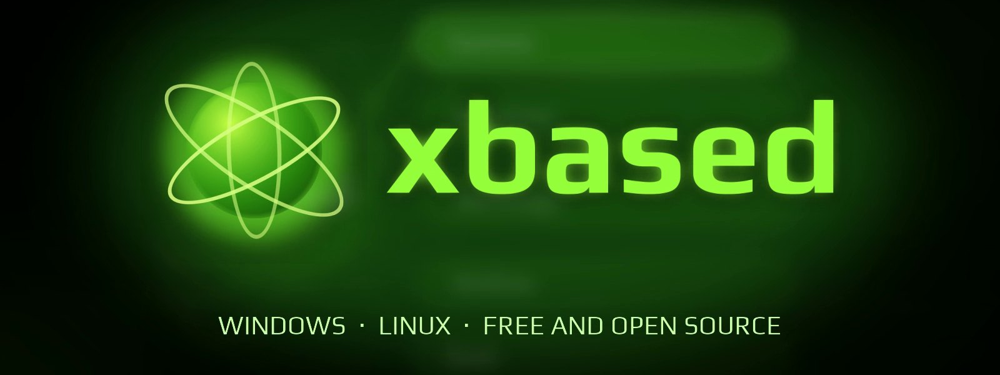
</p>

<p align="center">
  <b>xbased Modern GUI: the original Xbox on your PC, with a refreshed dashboard.</b><br>
  A fork of <a href="https://github.com/crazyriddler/xbased">xbased</a> by <b>crazyriddler</b>, which is based on <a href="https://github.com/rfandango/hakuX">hakuX</a>.<br>
  Free and open source.
</p>

<p align="center">
  <a href="https://github.com/Prodigy488/xbased-modern-gui/releases/latest"></a>
  
  
  <a href="COPYING"></a>
</p>

<p align="center">
  <a href="#download">Download</a> ·
  <a href="#features">Features</a> ·
  <a href="#screenshots">Screenshots</a> ·
  <a href="#getting-started">Getting started</a> ·
  <a href="#building-from-source">Building</a> ·
  <a href="#credits">Credits</a>
</p>

> **About this fork.** This is an unofficial fork of [xbased](https://github.com/crazyriddler/xbased)
> by crazyriddler (itself based on [hakuX](https://github.com/rfandango/hakuX)), currently on
> upstream 1.0.76. It is not made or supported by the xbased project: please report problems with
> this build [here](https://github.com/Prodigy488/xbased-modern-gui/issues), not upstream. What it adds: 11 dashboard styles in 3 themes (Original Blades by default),
> an Insignia tab with the Setup Assistant, play time, Resume (auto-save when leaving a game),
> floating covers and 3D cases, a Homebrew tab with a store, an OG Dashboard tab, GPU and disk-size
> settings, Nearest and NVIDIA NIS upscaling, pause on focus loss, a keyboard/mouse/controller
> setup like the [xemu Modern GUI](https://github.com/Prodigy488/xemu-modern-gui)'s (mouse as a
> stick, WASD layouts, quick save buttons), and a check that skips discs that are not Xbox images.
> Its update check follows this fork's releases. GPL-3.0, like upstream.

<!-- trailer -->
https://github.com/user-attachments/assets/bf62adff-002a-4dc6-9b28-eee775181646

<p align="center"><sub>Trailer for upstream xbased · <a href="https://youtu.be/0Kq3bW7XKxI">Watch on YouTube</a> · <a href="https://github.com/crazyriddler/xbased/releases/download/v1.0/xbased-trailer-1080p60.mp4">Download in 1080p60</a></sub></p>
<!-- /trailer -->

---

**xbased** runs original Xbox games on a PC with a reimplemented Xbox kernel,
a high-level NV2A renderer on Vulkan and an accurate MCPX audio core, behind a
console-style front end of its own.
No BIOS, MCPX ROM or hard-disk image is needed.

## Download

| Platform | File | |
|---|---|---|
| **Windows** 10/11 (x64) | `xbased-modern-gui-1.0.76.25-windows-x64.zip` | Unzip anywhere and run `xbased.exe`. Portable: everything stays in its folder. |
| **Linux** (x86-64) | `xbased-1.0.76.25-x86_64.AppImage` | `chmod +x` it and run it. Needs a Vulkan driver and glibc 2.38 or newer (Ubuntu 24.04, Fedora 39, Debian 13). |

Get it from **[Releases](https://github.com/Prodigy488/xbased-modern-gui/releases/latest)**.
The Linux AppImage starts, but it has not been run with a GPU or sound on Linux (it was
built without one). On an older distribution use the AppImage from
[upstream xbased](https://github.com/crazyriddler/xbased/releases/latest) or build this
source yourself (see [Building from source](#building-from-source)). There is no macOS build.

New builds are offered inside the app as it starts (Settings › Interface turns the check
off). People on upstream xbased or on an older build need to download this zip once by
hand; after that the updates come from this repository.

The Modern GUI features were written without a GPU to test on. The dashboard skins and the
NVIDIA NIS maths were checked on a CPU; the rest is built and reviewed but not run on real
hardware by the author. Please report anything odd.

**Requirements:** a GPU with Vulkan 1.1 or newer (1.3 recommended), a CPU with
SSE4.1, and your own game images (ISO / XISO) dumped from discs you own.
xbased doesn't include any copyrighted Xbox software.

## Features

<table>
<tr>
<td width="50%" valign="top">

### Like a console
- **Console-style dashboard**: an animated green orb, drifting hexagons, 3D
  transitions and navigation sounds.
- **Gamepad, keyboard or mouse** everywhere; button prompts follow the device
  you're using.
- **Borderless full screen by default**, any resolution, ultrawide or portrait,
  any DPI.
- **Exit from the gamepad**, with a confirmation.
- **Automatic updates**: a new release is offered as xbased starts and
  installs itself (Settings › Interface turns the check off and on).

</td>
<td width="50%" valign="top">

### Your library
- **Automatic box art** and the discs' own title icons.
- **Big libraries**: hundreds of games across many folders and drives load
  in the background (a counter shows how many so far) and are playable as
  they come; the list is back at once the next time.
- **Search and filters**: by name, publisher, year and region, typed on the
  keyboard or on an on-screen keyboard with the gamepad. Order by name
  (numbers first, then A to Z), publisher or year, and jump between letters
  with the triggers (Z and C on the keyboard).
- **Three views**: large covers, small covers or icons with names (the View
  button or V).
- **Favorites and the last played first**, each one can be turned off.
- **A page per game**: play, load a state, settings, patches, controls; rename
  it, pick your own cover image, hide it, or make a **desktop shortcut** that
  starts it straight away (handy for Steam and other front ends).
- **Disc images**: ISO, XISO and **CHD** (`chdman createdvd` or `createcd`).
- **Memory manager**: your games' saves with their icons; export, import and
  delete.
- **Import from xemu**: xemu's saves copied in and re-signed so games accept
  them (Memory, Y).
- **Broad compatibility** with many games, inherited from hakuX.
- **Autofix for stalled games**: a game that stops drawing for 25 seconds is
  run again with another setting (one of nine switches the emulator already
  has, picked by what the threads and the GPU are doing), and the one that
  gets it past the stall is kept in that game's settings. Cancel it from the
  menu or turn it off in Settings. Not yet run on real hardware.

</td>
</tr>
<tr>
<td valign="top">

### Picture
- **Internal resolution** up to 8x, aspect ratio, widescreen and video modes.
- **FXAA**, **SMAA** (a sharper anti-aliasing for the higher render scales) and **anisotropic filtering** up to 16x.
- **Frame interpolation** (Settings > Video, off): for a game slower than the display (30 fps on 60 Hz, 60 fps on
  120 Hz and up), a frame between each two, from the motion between them. It delays the picture by half a frame.
- **Upscaling**: bilinear or AMD FSR 1.
- **Sharpening** (Settings > Video, off): low, medium or high, for a picture no upscaler sharpens (Bilinear or
  Nearest; FSR and NIS have their own).
- **Integer scaling** (Settings > Video, off): the picture a whole number of times the console's lines tall, with
  borders; with the Nearest upscaler every pixel is a clean square.
- **Texture packs** (Settings > Video, off): PNG files in `hle/textures/<title id>/` of your data folder are drawn
  in place of the game's textures, at any size. "Write the game's textures out" fills that folder's `dump/` with
  the game's own, each named by its hash: edit or upscale one, keep the name, and put it one folder up.
- **Automatic texture upscaling** (Settings > Video, off): with [Real-ESRGAN](https://github.com/xinntao/Real-ESRGAN/releases)'s
  portable program (`realesrgan-ncnn-vulkan`, a separate download) unzipped into a `realesrgan` folder beside
  xbased (or in the data folder), the textures a game used are upscaled 4x after you leave it, in the
  background, and drawn the next time you play. The first sessions of a game look as before; it sharpens as
  the folder fills. It takes GPU time while it runs, and video memory in the game.
- **CRT filters**: soft scanlines, a classic TV, an arcade monitor.
- **Settings chosen for your PC**: the first start looks at the GPU and the display and sets the render scale,
  the filtering and the anti-aliasing to match (Settings > Video has a switch to choose them again).
- Every setting **global or per game**.

</td>
<td valign="top">

### Patches & mods
- **Per-game patches**: 60/120 fps, widescreen, fixes and cheats, toggled per
  game. Over 160 widescreen, 60 fps and 480p patches ship with it, plus a
  widescreen database for 90 games that finds its patterns in your disc's
  executable.
- **Cheats for 500 games**: the Xbox scene's cheat files (.etm, .xbtf)
  come with xbased and their options show up in each game's Mods & patches.
  Add your own to `cheats/<TITLE ID>/`.
- **Frame rate per game**: Original, up to 60, up to 120 or unlocked, where
  the game allows it (anything but Original can break a game).
- **Downloaded content and title updates** copied into
  `hdd/Partition1/TDATA/<title id>/` are signed for xbased as the game starts.
- **Add your own**: drop the IPS patches shared online into
  `mods/<TITLE ID>/` and they show up in the game's menu
  ([MODS.md](mods/README.md)).

</td>
</tr>
<tr>
<td valign="top">

### Save states & in-game menu
- **10 save-state slots per game**, with pictures.
- **In-game menu** with F1, or **Back + Start** / the **Guide** button on a
  gamepad: states, settings, controls, restart, back to the dashboard.
- **Shortcuts**: F5 quick save, F8 quick load, Tab fast forward, F2 pause,
  F12 screenshot, F11 full screen; all configurable.

</td>
<td valign="top">

### Controls, online, languages
- **Steel Battalion's controller**: for Steel Battalion the first port gets the game's big controller (levers,
  pedals, 40 buttons, gear lever, tuner dial) and your keyboard and gamepad drive it (see below).
- **4 controller ports**: Automatic, any gamepad or the keyboard; remap every
  button, per game too; dead zone and vibration.
- **Sticks like the Xbox controller's**: a modern stick's circle reaches the
  Duke's full square, so diagonals register. Stick range and shape are set
  on a screen that shows both sticks live, the range games expect and the
  range yours reaches. Triggers get their own calibration screen too (dead
  zone and full press).
- **PAL games at 60 Hz**, as with the console's PAL-60 setting on; 50 Hz is
  an option, for all games or one.
- **Stereo or 5.1 surround**: the games' Dolby Digital mix, six channels
  out (Settings › Audio; stereo by default).
- **Online**: Insignia (the community's Xbox Live replacement), XLink Kai and
  System Link on your network.
- **11 languages**, your system's by default. Games start in your language,
  or in English when the disc doesn't have it.

</td>
</tr>
</table>

## Screenshots

<table>
<tr>
<td width="50%">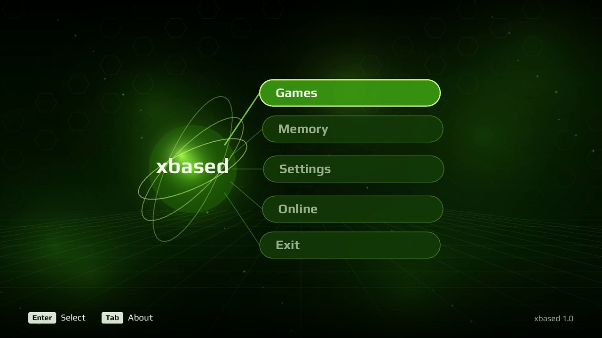<p align="center"><sub>The dashboard</sub></p></td>
<td width="50%">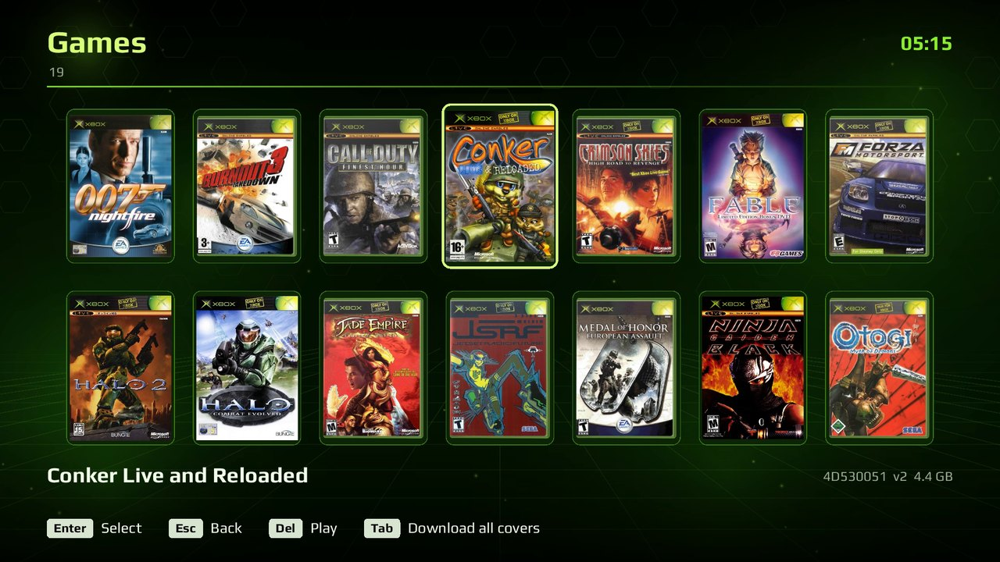<p align="center"><sub>Your library, with box art</sub></p></td>
</tr>
<tr>
<td>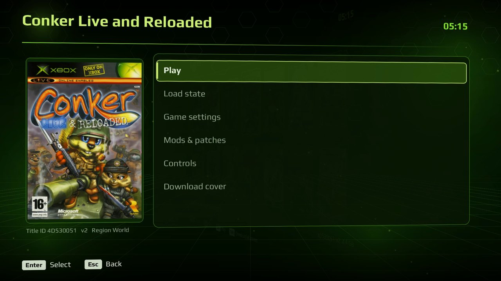<p align="center"><sub>A game's page</sub></p></td>
<td>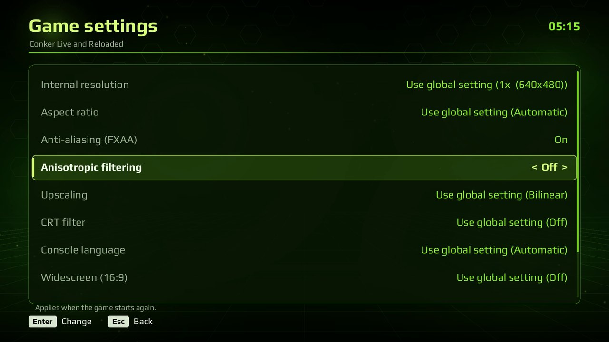<p align="center"><sub>Per-game settings</sub></p></td>
</tr>
<tr>
<td>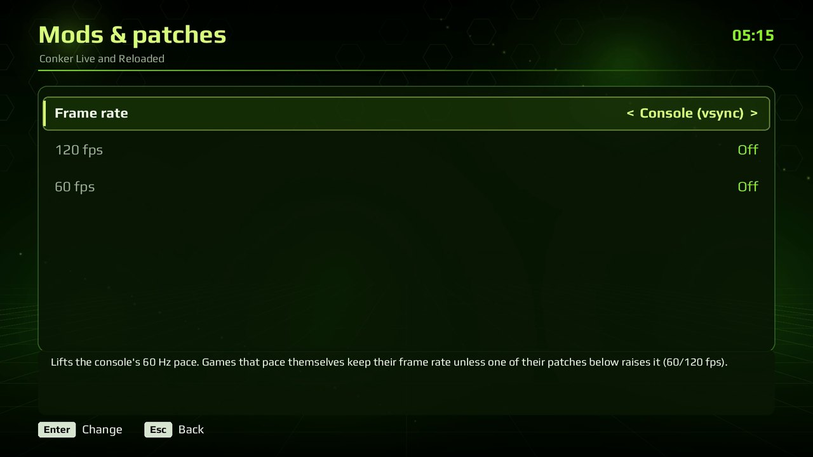<p align="center"><sub>Patches & mods</sub></p></td>
<td>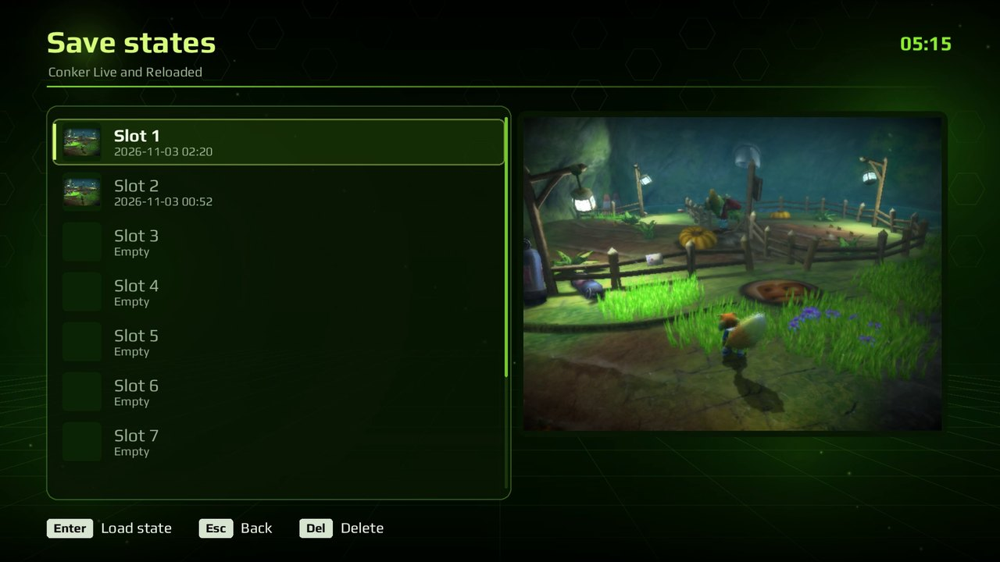<p align="center"><sub>Save states with pictures</sub></p></td>
</tr>
<tr>
<td>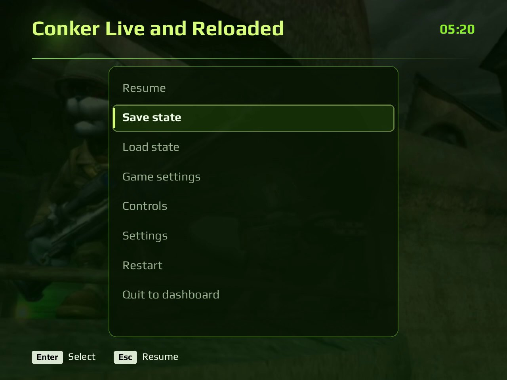<p align="center"><sub>The in-game menu</sub></p></td>
<td>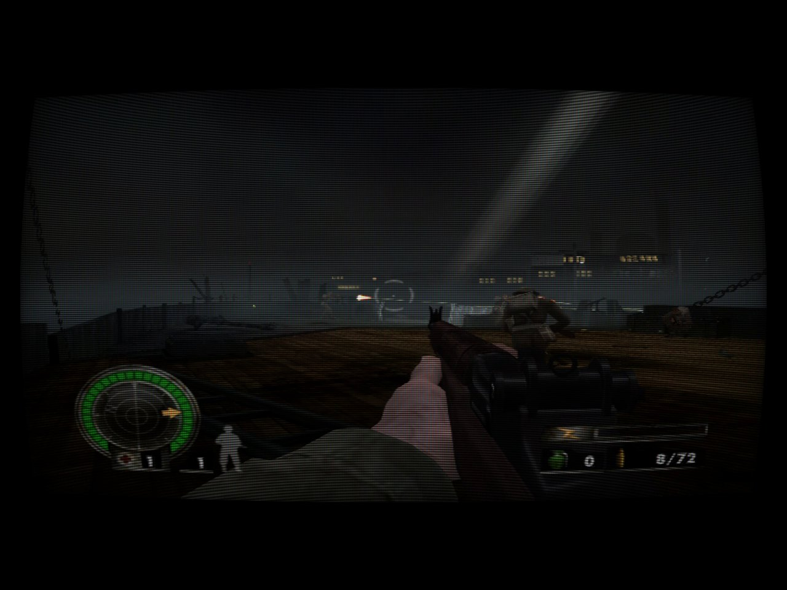<p align="center"><sub>A CRT filter</sub></p></td>
</tr>
<tr>
<td>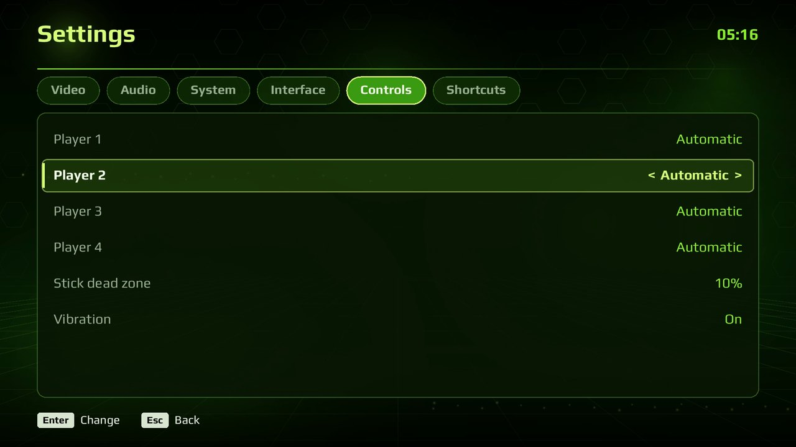<p align="center"><sub>4 controller ports</sub></p></td>
<td>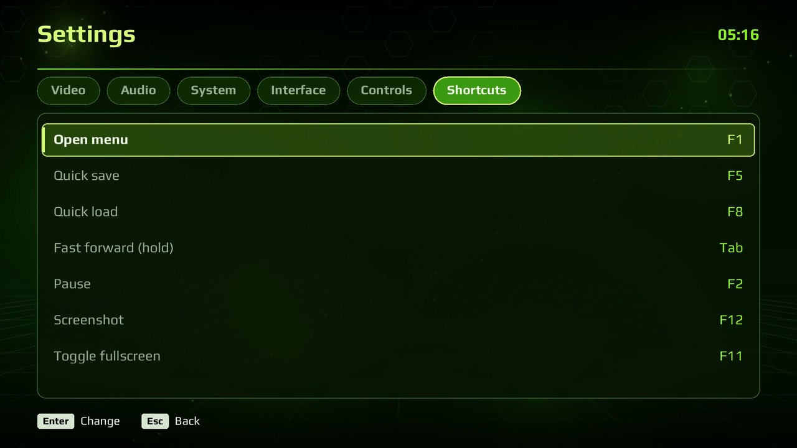<p align="center"><sub>Keyboard shortcuts</sub></p></td>
</tr>
<tr>
<td>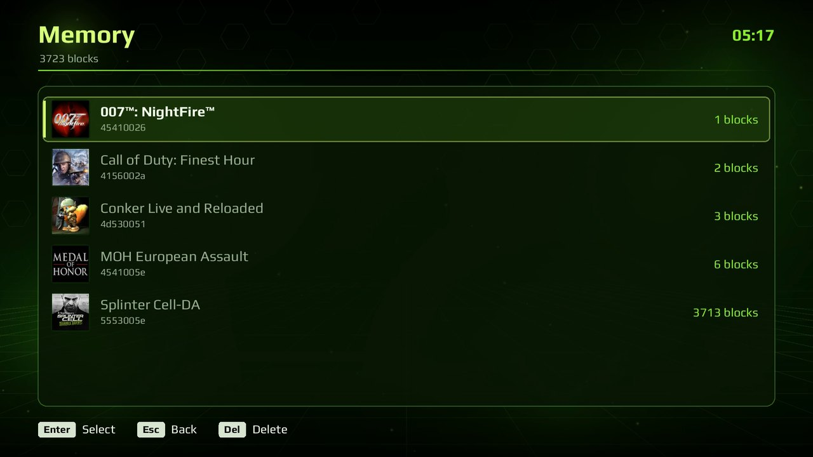<p align="center"><sub>Memory manager</sub></p></td>
<td>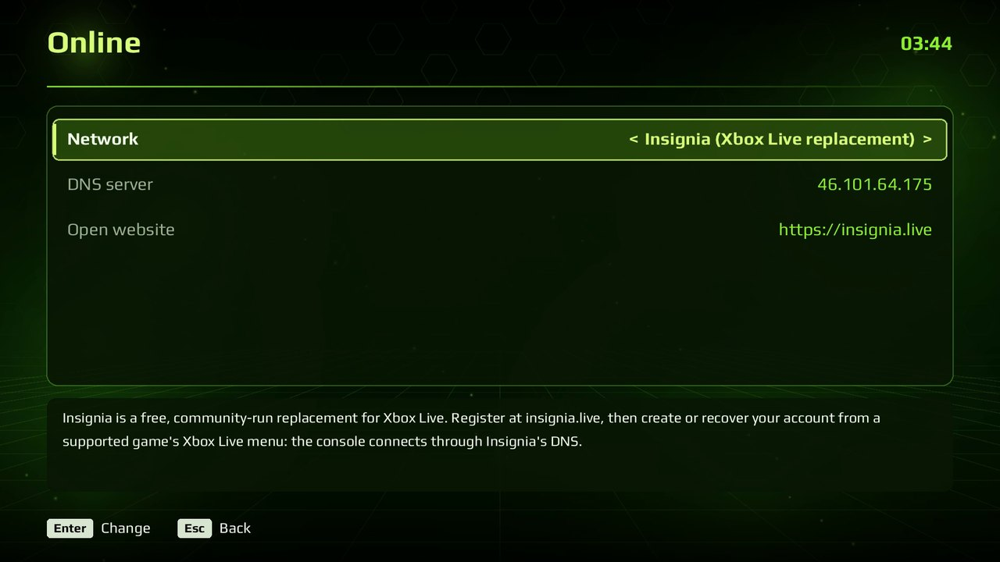<p align="center"><sub>Online: Insignia, XLink Kai, System Link</sub></p></td>
</tr>
</table>

<p align="center">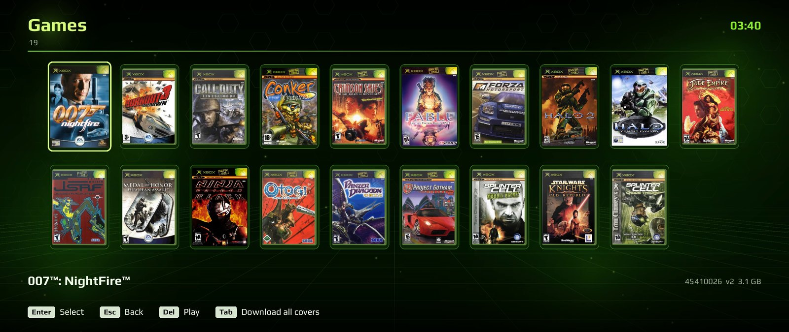<br><sub>Any screen: the dashboard at 21:9</sub></p>

## Getting started

1. Download xbased Modern GUI from [Releases](https://github.com/Prodigy488/xbased-modern-gui/releases/latest):
   unzip it anywhere (Windows) or run the AppImage (Linux).
2. Start it: the dashboard opens. In **Games**, choose **Add games** (the last
   card, or A on an empty library) to open the file browser: go to the folder
   with your disc images and press X to add it, or A on a single image to add
   just that one. It works with a gamepad, the keyboard or the mouse, and
   lists every drive or mounted disk with its free space.
3. Choose a game in **Games**. Box art downloads automatically (it can be
   turned off).

Command line: `xbased <image.iso or .chd> [options]` starts a game directly; options
are the same as the settings files' lines (`scale=2`, `uncap`, `crt=2`,
`fullscreen=0`, `mod=<patch>`...). Settings are kept in `xbased.ini` (global)
and `games/<TITLE ID>.<version>.ini` (per game) beside the executable on
Windows, in `~/.local/share/xbased/` on Linux.

### Default keyboard controls

| Xbox | Key | Xbox | Key |
|---|---|---|---|
| A / B / X / Y | Space / Left Shift / Q / E | Left stick | W A S D |
| Black / White | C / Z | Right stick | I J K L |
| Left / right trigger | 1 / 3 | D-pad | Arrow keys |
| Start / Back | Enter / Backspace | Stick clicks | F / H |

**Shortcuts:** F1 menu, F5 quick save, F8 quick load (Shift: slot 2), Tab fast
forward (hold), F2 pause, F12 screenshot, F11 full screen. On a gamepad,
Back + Start or the Guide button opens the menu.

### Steel Battalion

Steel Battalion (title 43430002) only plays with its own controller: 40-odd buttons, two levers, a sight
stick, three pedals, a tuner dial and a gear lever. xbased gives the game that controller on port 1
(automatically for that title; `sbc=1` or `sbc=0` in the game's `games\<TITLE ID>.ini` forces it on or off,
for Line of Contact for one) and drives it from your keyboard and gamepad. The panel lamps the game lights
are not shown anywhere yet.

**Gamepad:** right stick aims, left stick left/right turns (the rotation lever), left stick down is the
middle pedal, LT / RT the left / right pedal, D-pad the sight stick, LB / RB gear down / up, A fire,
X main weapon, Y lock on, B sight change, Start start. **Hold Back** and the pad works the cockpit panel:
A ignition, B cockpit hatch, X mode select, Y monitor open/close, LB / RB tuner dial, and the five toggle
switches (a press flips one; the start-up has them flipped in this order): D-pad up, right, down, left, then
left stick click (filter control, oxygen supply, fuel flow rate, buffer material, VT location); right stick
click the extinguisher. The comms, washing and the other buttons are on the keyboard. (The quick-save combo on Back is off for this game: F5 / F8 save and load.)

**Keyboard (all of the controller):**

| Control | Key | Control | Key |
|---|---|---|---|
| Aiming lever | Arrow keys | Rotation lever | A / D |
| Sight change stick | I J K L | Sight change button | F |
| Left / middle / right pedal | Z / X / C | Gear lever up / down | Q / E |
| Tuner dial down / up | , / . | Fire / main weapon / lock on | Space / Left Shift / Left Ctrl |
| Cockpit hatch / ignition / start | R / T / Enter | Eject | Delete |
| Monitor open, map zoom, mode, sub monitor | 1 2 3 4 | Main zoom in / out | = / - |
| FSS, manipulator, line color | 5 6 7 | Washing, extinguisher, chaff | 8 9 0 |
| Tank detach, override, night scope | Insert, Home, Page Up | F1, F2, F3 | End, Page Down, ' |
| Weapon: main, sub, magazine | Y U O | Comm 1-5 | V B N M ; |
| Toggle switches (a press flips one) | P [ ] \ / | | |

This is the controller as the Xbox dev wiki describes it, tested here only with the controller's own USB
descriptors and reports in a host test, not with the game: if the game doesn't see it, or a lever or pedal
reads wrong, the log (`xbased.log`) has what the game reads from the controller as it changes ("the title reads buttons") and the lamps it lights ("lamps lit").

## Building from source

xbased builds with clang and CMake. The third-party sources are fetched at
pinned versions by `tools/fetch_deps.sh` into a `deps` folder beside the
repository:

```
<work>/
  xbased/      this repository
  deps/        third-party sources (tools/fetch_deps.sh)
  build/       build trees
```

The executable is built from the `hakux` target and named `xbased`.

### Windows (x64)

1. Install [MSYS2](https://www.msys2.org/) and open the **MSYS2 CLANG64** shell.
2. Install the toolchain:

   ```bash
   pacman -S --needed git mingw-w64-clang-x86_64-clang mingw-w64-clang-x86_64-lld \
     mingw-w64-clang-x86_64-cmake mingw-w64-clang-x86_64-ninja mingw-w64-clang-x86_64-python
   ```

3. Get the source, fetch the dependencies and build:

   ```bash
   git clone https://github.com/Prodigy488/xbased-modern-gui
   cd xbased-modern-gui
   tools/fetch_deps.sh
   cmake -S native -B ../build/win -G Ninja -DCMAKE_BUILD_TYPE=Release \
     -DCMAKE_C_COMPILER=clang -DCMAKE_CXX_COMPILER=clang++
   cmake --build ../build/win --target hakux
   ```

`../build/win/xbased.exe` runs from the build folder (its fonts and mods are
copied beside it). It imports only system DLLs, so it runs on any Windows
10/11 x64 with a Vulkan driver. To make the release zip in `../dist`
(PowerShell): `tools\release\package_windows.ps1`

### Linux (x86-64)

1. Install the packages (Ubuntu/Debian; on other distributions, the same
   libraries' development packages):

   ```bash
   sudo apt install git clang lld cmake ninja-build pkg-config python3 zlib1g-dev \
     libx11-dev libxext-dev libxrandr-dev libxcursor-dev libxi-dev libxss-dev libxtst-dev libxfixes-dev \
     libxkbcommon-dev libwayland-dev wayland-protocols libegl-dev libgl-dev libdecor-0-dev \
     libdrm-dev libgbm-dev libasound2-dev libpulse-dev libpipewire-0.3-dev libudev-dev \
     libdbus-1-dev libibus-1.0-dev
   ```

2. Get the source, fetch the dependencies and build:

   ```bash
   git clone https://github.com/Prodigy488/xbased-modern-gui
   cd xbased-modern-gui
   tools/fetch_deps.sh
   cmake -S native -B ../build/linux -G Ninja -DCMAKE_BUILD_TYPE=Release \
     -DCMAKE_C_COMPILER=clang -DCMAKE_CXX_COMPILER=clang++
   cmake --build ../build/linux --target hakux
   ```

`../build/linux/xbased` runs from the build folder. Settings, saves and states
go to `~/.local/share/xbased` (or beside the executable when a `portable.txt`
is there). SDL3 is linked statically; at run time the system needs glibc 2.35
or newer and a Vulkan driver (Mesa or the GPU vendor's). To make the AppImage
in `../dist`: `tools/release/package_linux.sh ../build/linux` (the release
one is built on Ubuntu 22.04, so it runs there and on newer distributions).

More options (link-time optimization, the dependencies' location) are in
[BUILDING.md](BUILDING.md).

## Credits

- **xbased Modern GUI** is a fork by **[Prodigy488](https://github.com/Prodigy488)**, made
  with Claude (Anthropic). It adds the dashboard styles, Insignia and Homebrew tabs, NVIDIA
  NIS upscaling (a port of [NVIDIA Image Scaling](https://github.com/NVIDIAGameWorks/NVIDIAImageScaling),
  MIT licence in [licenses/](licenses/)), SMAA anti-aliasing (the
  [reference implementation](https://github.com/iryoku/smaa) by Jimenez et al., MIT licence in
  [licenses/](licenses/)), frame interpolation, the input settings and the other changes
  listed [above](#download). Everything else is upstream's work, credited below.
- **xbased** by **[crazyriddler](https://github.com/crazyriddler)**, its creator
  and maintainer: the emulator for x86-64 Windows and Linux, the
  console-style dashboard and front end, the game fixes (Fable, The Thing,
  BloodRayne 2, NFL Fever 2004, Panzer Dragoon Orta and more), internal
  resolution up to 8x, 5.1 audio, the automatic updates and every release
  ([CHANGELOG.md](CHANGELOG.md)).
- Based on **[hakuX](https://github.com/rfandango/hakuX)**. Its README and
  changelog are in [docs/hakuX](docs/hakuX/).
- Box art from the [libretro-thumbnails](https://github.com/libretro-thumbnails)
  project. Interface font: Play (SIL Open Font License).
- SDL3, Zydis, libslirp, libchdr, xxHash, volk, Vulkan Memory Allocator, glslang,
  SPIRV-Reflect and the other components listed in [LICENSE](LICENSE).

## Thanks

xbased's cheat and patch database is the work of the Xbox community, and
it's here thanks to them:

- **The cheat makers of the Xbox scene**: xboxtrainers.net, Team Evox-T,
  Team Xored, Angelfly, k_away, Hitman, RoBoZeO, Falcon3, Thatguy, Xor and
  everyone else who made the .etm and .xbtf cheat files EvolutionX,
  Avalaunch and XBMC4Xbox ran (known there as trainers). The files come from
  the [Xbox Original ETM Trainers](https://archive.org/details/ETMTrainers)
  collection on the Internet Archive.
- **[XBMC4Xbox](https://github.com/Rocky5/XBMC4Xbox)** and Team Xored, whose
  trainer loader showed how those files run (xbased loads the same helper
  routines for .xbtf files).
- **[icup321](https://github.com/icup321/XboxGraphicalPatches)** and
  **[Slippy2k](https://github.com/Slippy2k/XboxGraphicalPatches)** for their
  widescreen, 60 fps and 480p patches, and the **OgXHD** widescreen
  database that comes with them.
- **[xemu](https://xemu.app)** and its [xdb](https://github.com/xemu-project/xdb)
  title database, which matched every patch to its game.
- **[raddad772](https://github.com/raddad772)**, whose measurements of the
  audio chip on a retail console (xemu pull request
  [#3105](https://github.com/xemu-project/xemu/pull/3105)) the sound
  emulation follows: the HRTF taps and routing, the filters, the resampler,
  the volume curve, envelopes, LFOs and ramps.
- **[P1Login](https://github.com/P1Login)**, for testing on AMD hardware,
  logs, workarounds for other users and the help across many issues.
- Everyone who reports issues, tests games and shares saves and logs: that's
  how the games on the list got fixed.

## License

xbased, like hakuX, is free software under the GNU General Public License,
version 3 or later ([COPYING](COPYING)). The third-party components keep their
own licenses ([LICENSE](LICENSE), [licenses/](licenses/)).

<sub>xbased is not affiliated with or endorsed by Microsoft. Xbox is a trademark
of Microsoft Corporation. Game names and box art shown belong to their owners.</sub>
